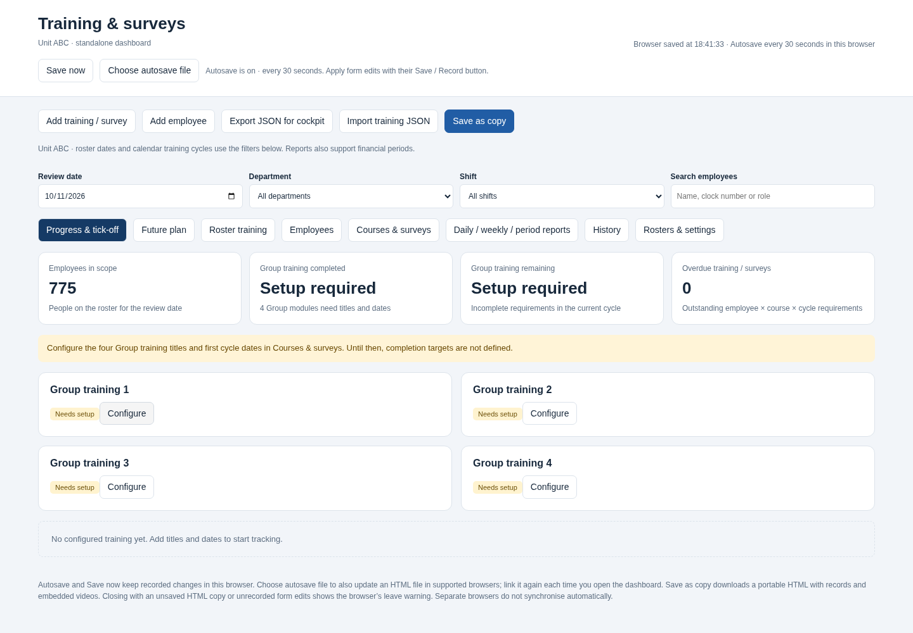
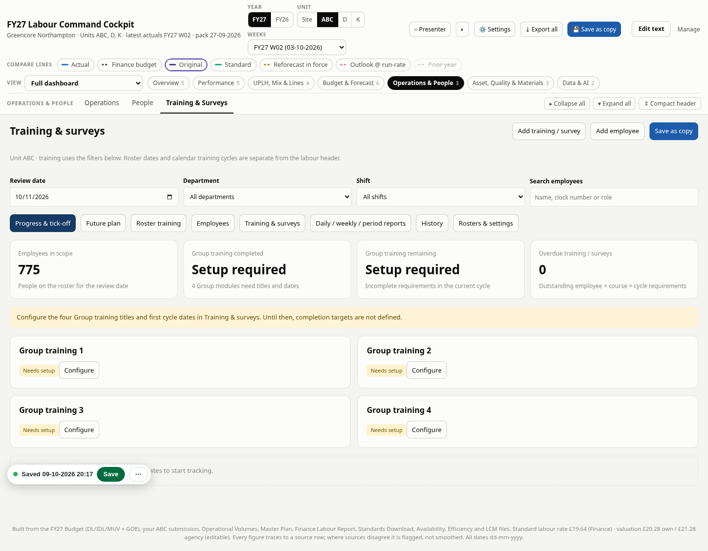
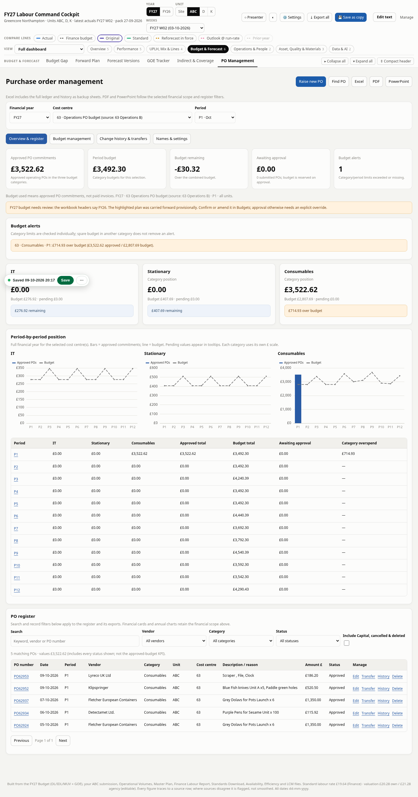
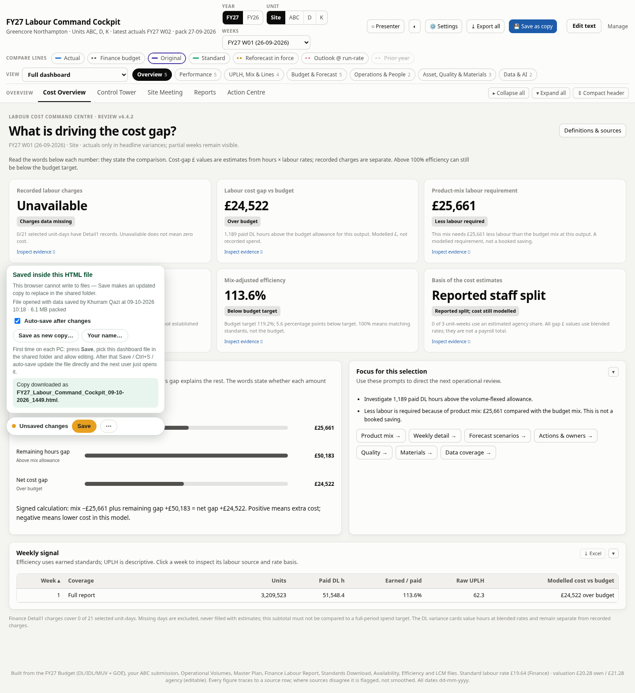
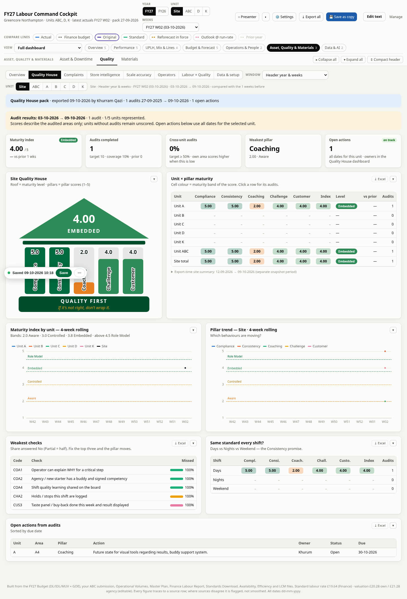

# Labour cockpit and standalone training dashboard

This repository contains a portable labour/cost/PO cockpit and an independent roster-backed training application. It contains employee and business data; keep the repository private.

## Latest cockpit: Daily Labour / UPLH — Phase 1

Use **[GC_NH_Cockpit_Daily_Labour_Phase1.html](GC_NH_Cockpit_Daily_Labour_Phase1.html)** ([ZIP with guide](GC_NH_Cockpit_Daily_Labour_Phase1.zip)). Open **Operations & People → Daily Labour / UPLH**. The supplied 13 October Crown export and ABC roster are embedded. The module adds production-window clock hours, DL/IDL/LC/excluded classification, employee and role review, exceptions, roster audit, Prep KG, history and Excel/JSON export. It preserves the latest supplied cockpit's **4,283 complaints and 172 POs**, existing views, settings and data.

Efficiency output and official Labour Report mapping remain for Phases 2/3; UPLH is visibly unavailable until output is supplied. The existing same-file save, 30-second autosave and leave warning remain. See **[source mappings, unresolved records, assumptions, changelog and validation](Daily_Labour_Phase1_Guide.md)**.

## Daily complaints report the previous day

Use **[Daily complaint reporting updater](Cockpit_Daily_Complaints_Updater.html)** on your latest saved cockpit. A report dated 13 October now reads complaints dated 12 October, labels both dates and shifts complaint comparisons consistently. It adjusts SQDCP Daily and the Quality Daily brief, preserving the other measures' dates, range reports, data and same-file saving. See the **[daily reporting guide](Daily_Complaints_Reporting_Guide.md)**.

## Save to one master HTML

Use **[Save to the same file updater](Cockpit_Save_To_Same_File_Updater.html)** to install the adjustment into your **latest saved cockpit** without changing its name. Both top **Save dashboard** and bottom **Save** then update the linked master, asking you to select it once if needed. Normal saves make no downloads; explicit Download copy remains available. See the **[same-file saving guide](Same_File_Saving_Guide.md)**.

## OpenAI error and single-file saving update

If OpenAI refuses a request or Save keeps creating downloads, use the small **[OpenAI and saving updater](Cockpit_OpenAI_Error_Updater.html)** on your **own latest saved cockpit**. It preserves your new data, exposes the redacted server error and makes linked-file saving clearer, with previous versions stored in the browser instead of automatic backup downloads. See **[step-by-step instructions](OpenAI_Error_and_Saving_Update.md)**. The updater does not fix an OpenAI permission or work-network block by itself.

## Prior cockpit: Quality review, reports and saving repairs

Use **[GC_NH_Cockpit_Quality_PO_SHE_v6_7.html](GC_NH_Cockpit_Quality_PO_SHE_v6_7.html)** ([ZIP download](GC_NH_Cockpit_Quality_PO_SHE_v6_7.zip)). It updates the supplied 13 October 10:56 cockpit with Quality visuals, daily/weekly/custom reports, chart PNGs, Excel/PDF/PowerPoint and a single team slide. The original 4,271 tickets and 172 POs are preserved. It also fixes loading while the original tab is open, full-copy saving independent of a damaged file, 30-second browser autosave and inclusion of future SHE entries in saved copies. See the **[Quality reporting and recovery guide](Quality_Reporting_Guide.md)**.

**Existing SHE manual entries still require the separate SHE backup from the original working tab.** Import it through the bottom save menu before assuming those figures are recovered. Keep that original tab open until checked.

## OpenAI complaints analysis

Use **[Cockpit_Cost_PO_OpenAI_v6_5_1.html](Cockpit_Cost_PO_OpenAI_v6_5_1.html)** for the uploaded v6.5 cockpit with **OpenAI API** replacing Claude in complaints classification and the general AI analyst. Add your own key and password in Settings, enable OpenAI and save settings. The local encrypted key is excluded from saved HTML/JSON. All supplied data and existing classifications are preserved. See the **[OpenAI connection and password guide](OpenAI_Cockpit_Guide.md)**. The independent training dashboard and its companion cockpit below remain separate versions.

## Download and open

For training, use **[ABC_Training_Survey_Dashboard_v1.html](ABC_Training_Survey_Dashboard_v1.html)** — approximately **1 MB**, with both rosters already included. It runs independently of the cockpit.

1. Open the file on GitHub and click **Download raw file**.
2. Save it with the `.html` extension, then open it in a current Chrome or Edge browser.
3. Configure the four Group training titles and cycle starts. Recorded changes autosave in the browser every **30 seconds**; **Save now** is also available. Use **Choose autosave file** in supported browsers to update an HTML file automatically, or **Save as copy** to download a portable copy.

To bring its records into the command centre, use **Export JSON for cockpit**, then **Import training JSON** in **[Cockpit_Cost_PO_Training_v6_6_1.html](Cockpit_Cost_PO_Training_v6_6_1.html)**. Download that companion cockpit the same way; it is approximately 27.7 MB. JSON import replaces only its training snapshot and provides an undo option.

See the **[standalone and JSON-transfer guide](Training_Standalone_Guide.md)** for the workflow and validation. Separate browsers do not automatically synchronise. The dashboards do not require a build or installation.

## What changed

Standalone Training v1 now includes a 30-second autosave, **Save now**, optional linked HTML-file autosave, accurate save status after reopening, and leave/discard warnings for unsaved copies or unfinished forms. It separates training and roster management from the cockpit. Companion cockpit v6.6.1 adds a validated JSON snapshot importer/exporter, optional video transfer, import preview and undo, while preserving all prior cockpit datasets. The earlier integrated v6.6 file remains available as a historical review version.

Version 6.6 adds **Training & Surveys** under Operations & People, with both supplied April–March rosters, editable employees and courses, four Group training setup slots, three-calendar-month cycles, completion evidence and corrections, surveys, roster training mapping, future availability planning, daily/weekly/financial-period reports, Excel/PDF exports, video links or offline attachments, history and Control Tower KPIs. Configure the four actual titles and cycle starts before tracking their targets. It opens on the training page. See [training usage, source matching and validation](Training_Management_Notes.md).

The roster import identifies 775 people this year and 781 next year; missing clocks and three conflicting clock/name matches need review. Scheduled roster training is kept separate from confirmed completion. Separate browsers do not automatically synchronise; use one master-copy owner for team tick-off.

Version 6.5 adds **PO Management** under Budget & Forecast: 171 imported POs, category/period budget monitoring, approval alerts with recorded overrides, edits/amendments, Capital and cost-centre transfers, retained deletion/history, keyword/vendor/PO search, editable budgets and headings, future-year budget creation, Excel/PDF/PowerPoint exports and Control Tower KPIs. It uses the latest supplied cockpit and retains existing datasets.

The source has 147 Repairs POs outside the three new categories, preserved as legacy records. The budget sheets say FY26 and differ from the filename/requested sheet name. The highlighted 63 Operations (B) plan is carried into FY27 provisionally and flagged for review in the budget panel. See [PO usage, source decisions and validation](PO_Management_Notes.md).

After changes, use **Save as copy** and choose this updated v6.6 file to retain the edited data inside the portable HTML.

Version 6.4.2 fixes Quality House audit visibility and includes the supplied 9 October pack. Quality House follows the header year and weeks by default; rolling windows include the current week. It shows the dates and audit coverage, explains empty selections, and offers a button to show the latest audit. Actions are explicitly labelled as using all dates for the selected unit.

The supplied pack contains one live Unit A audit, dated 9 October 2026: maturity 4.00/5, with Coaching weakest at 2.00/5, and one open action. Other units remain unscored. This is limited audit coverage, not evidence of maturity across the whole site. The original labour records and cost calculations are retained.

Version 6.4.1 replaced colour-based interpretations with neutral numbers and explicit comparison labels. The efficiency card shows the distance from its budget target, the cost bridge states its signed arithmetic, and missing charges are distinguished from zero cost.

- Cost Overview separates recorded charges from modelled direct-labour variance.
- Product mix and the execution/other residual reconcile to the modelled gap.
- Mix-adjusted efficiency compares earned standard hours with paid hours and the budget target.
- Mobile filters, navigation, tables and source drawers fit smaller screens.
- Faster startup and lazy history loading; navigation no longer triggers full-file autosaves.
- Improved saving, revision checking and storage-failure recovery.

See [review notes and validation](Review_Notes.md) for coverage, calculations and limits. Recorded charges have partial coverage; modelled variances are not payroll spend or product profit.

## Preview

[Standalone mobile preview](previews/Standalone_Mobile.png)

[Training mobile preview](previews/Training_Mobile.png)

[PO management mobile preview](previews/PO_Mobile.png)

[Mobile preview](previews/Cost_Overview_Mobile.png)

[Quality House mobile preview](previews/Quality_House_Mobile.png)

## Daily Labour Phase 2

The standalone `GC_NH_Cockpit_Daily_Labour_Phase2.html` includes the inspected `eff.xlsx` production runs and computes provisional Flash DL UPLH against Crown DL hours. `Cockpit_Daily_Labour_Phase2_InPlace_Updater.html` installs the same module into an already saved Phase 1 cockpit without changing its other source data blocks. See `Daily_Labour_Phase2_Guide.md` for mapping, results, caveats, and use. Rebuild with `python scripts/build-daily-labour-phase2.py --efficiency /path/to/eff.xlsx`, then `python scripts/build-daily-labour-phase2-updater.py`.
